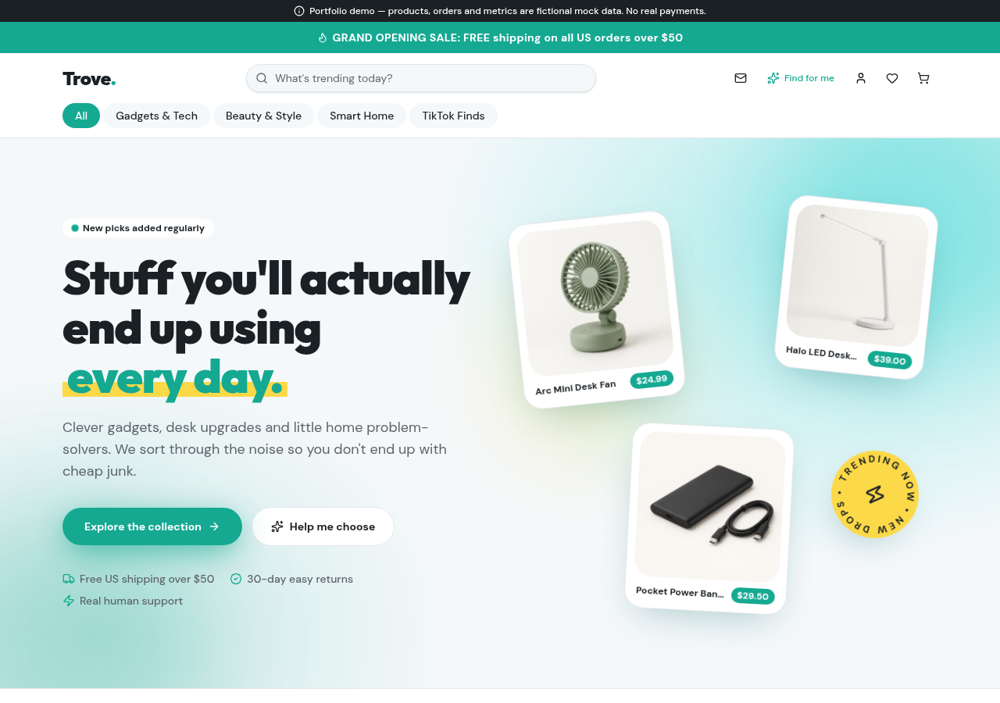
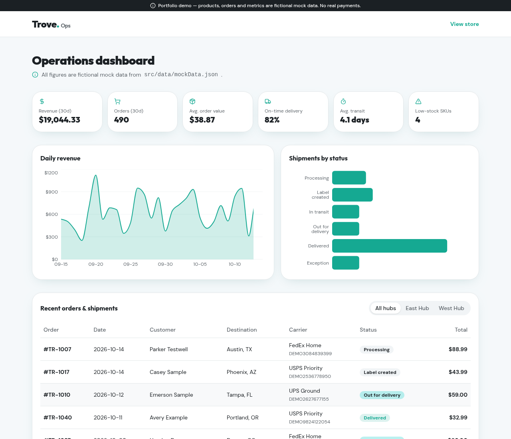

# Trove — Headless E-commerce Storefront & Ops Dashboard

A full-stack e-commerce storefront for a US-market "curated gadgets & home finds" shop, plus an internal operations dashboard for sales, shipping and inventory. Built with TanStack Start, React 19 and Tailwind CSS v4.

> **Portfolio edition.** "Trove", its products, customers, orders and metrics are fictional. The app runs entirely on local mock data — no API keys, database or payment account needed. See [Confidentiality & Data Protection](#confidentiality--data-protection).




---

## Features

**Storefront**
- Animated home page: rotating headline, floating product collage, auto-scrolling "Trending now" strip (arrows, drag and swipe), scroll reveals.
- Editorial product grid with a featured "Staff pick", category filters (Gadgets & Tech, Beauty & Style, Smart Home, TikTok Finds) and "moment of use" filters (Desk & Focus, On the Go, Home & Chill, Under $25).
- Live search, quick-view dialog, and product pages with variant pickers, image gallery and a sticky mobile buy bar.
- Persistent cart drawer with a free-shipping progress bar ($50 threshold) and a small celebration when it's reached.
- **Product finder** (`/finder`): customers describe what they need, a budget and preferences; a weighted keyword and synonym matcher on the server recommends up to 4 catalog items with a reason for each.
- Honest social proof: an empty review state instead of made-up ratings.

**Checkout & accounts (simulated)**
- Checkout with address form, order summary and the shipping rule (free at $50+, otherwise a flat $4.99), then an order confirmation page.
- Demo customer accounts: sign in / sign up with a password strength meter, order history, an editable profile and address, and favorites.

**Operations dashboard** (`/admin`)
- KPI cards: revenue, orders, average order value, on-time delivery rate, average transit time, low-stock SKUs.
- Daily revenue area chart and shipments-by-status bar chart (Recharts).
- Recent orders & shipments table with carrier, tracking number and status, filterable by fulfillment hub.
- Inventory table flagging SKUs at or below their reorder point.

**Platform**
- Server-side rendering with per-route SEO metadata, an auto-generated `sitemap.xml`, and `robots.txt`.
- Support pages (Contact, Shipping, Refund, Terms, Privacy) on a shared layout; the contact form opens a pre-filled email draft.
- Responsive from 320 px phones to wide desktops.

## Tech stack

| Area | Tools |
| --- | --- |
| Framework | [TanStack Start](https://tanstack.com/start) (React 19, SSR, server functions), TanStack Router (file-based) |
| Data | TanStack Query, local JSON mock data |
| State | Zustand with `localStorage` persistence (cart, favorites, demo session) |
| UI | Tailwind CSS v4, shadcn/ui (Radix UI), lucide-react, Recharts, Sonner |
| Validation | Zod |
| Tooling | Vite, TypeScript, Vitest + Testing Library, ESLint, Prettier |
| Deploy target | Edge runtime (Cloudflare Workers compatible build via Nitro) |

## Getting started

**Requirements:** Node.js 20+ and [Bun](https://bun.sh) (or npm).

```sh
git clone https://github.com/<your-username>/trove-storefront.git
cd trove-storefront
bun install          # or: npm install
cp .env.example .env # optional — every value has a fictional default
bun run dev          # or: npm run dev
```

Open the URL printed in the terminal (usually http://localhost:8080 or http://localhost:3000).

| Command | What it does |
| --- | --- |
| `bun run dev` | Start the dev server with hot reload |
| `bun run build` | Production build |
| `bun run preview` | Preview the production build |
| `bun run test` | Run the unit tests (Vitest) |
| `bun run lint` | Lint the codebase |

**Try it:** add a product under $50 to the cart and watch shipping change at checkout; place a demo order; use **Continue as demo customer** on `/auth` to see order history; open `/admin` for the dashboard.

## Project structure

```text
src/
  data/mockData.json     Fictional catalog, customer, orders, inventory and daily metrics
  lib/catalog.ts         Catalog access + store rules (shipping); swap point for a real API
  lib/ops-metrics.ts     KPI calculations for the dashboard
  lib/recommend.*.ts     Product finder (server function + keyword matcher)
  stores/                Zustand stores: cart, wishlist, demo session & orders
  routes/                File-based routes (storefront, checkout, account, admin, policies)
  components/trove/      Storefront components
  components/ui/         shadcn/ui primitives
public/mock/products/    Generated product images (fictional items)
```

## Environment variables

See [`.env.example`](.env.example). The demo only reads public, non-secret `VITE_*` values (store name, domain, support email, site URL). Real `.env` files are git-ignored. If you connect real services, keep secret keys in server-only variables (never prefix them with `VITE_`) and read them only inside server functions.

---

## Confidentiality & Data Protection

> **This repository contains no real business data, credentials or private integrations.**

This project is based on work built for a client, published here as a portfolio piece. To protect privacy and honor confidentiality obligations (NDA):

- **Real data replaced with mock data.** All products, prices, customers, orders, tracking numbers, inventory levels and sales metrics come from `src/data/mockData.json` and are fictional. Customer names, addresses and phone numbers are made-up placeholders; emails and domains use reserved example domains (`example.com`, `.example`).
- **Private APIs and backends removed.** The original commerce platform API, payment processor, database, authentication provider, transactional email, webhooks and AI integrations were removed. Sign-in, checkout and order history are simulated in the browser — no payment is taken and nothing is sent to a server.
- **No secrets in the code.** No API keys, tokens, passwords or internal URLs are included. Configuration lives in environment variables documented in `.env.example` with generic values.
- **Branding anonymized.** The store name, domain, logo and product images were replaced with a fictional brand ("Trove") and generated imagery.

Any resemblance to real stores, products or people is coincidental.

## License

Source code is shared for portfolio and review purposes. Product images in `public/mock/` are generated and fictional.
